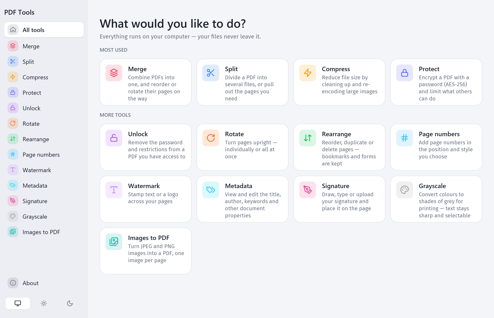
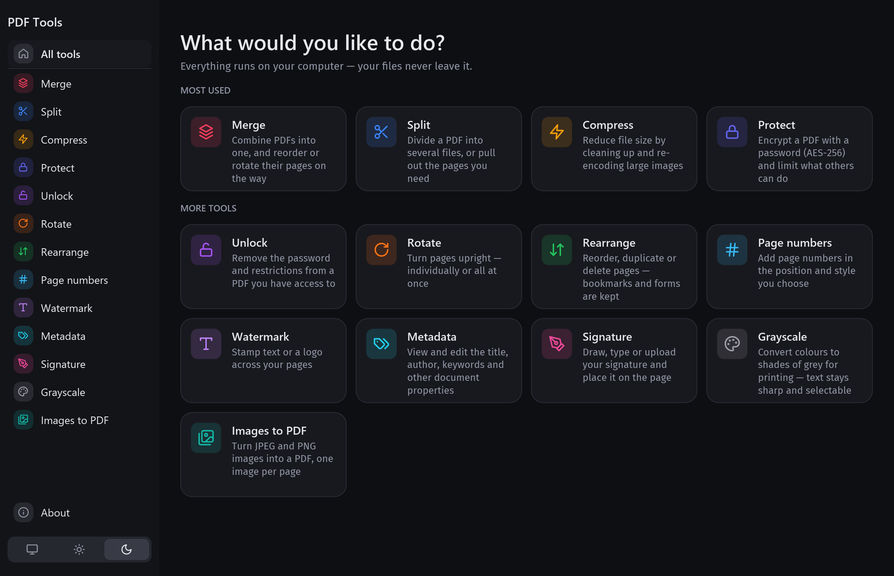
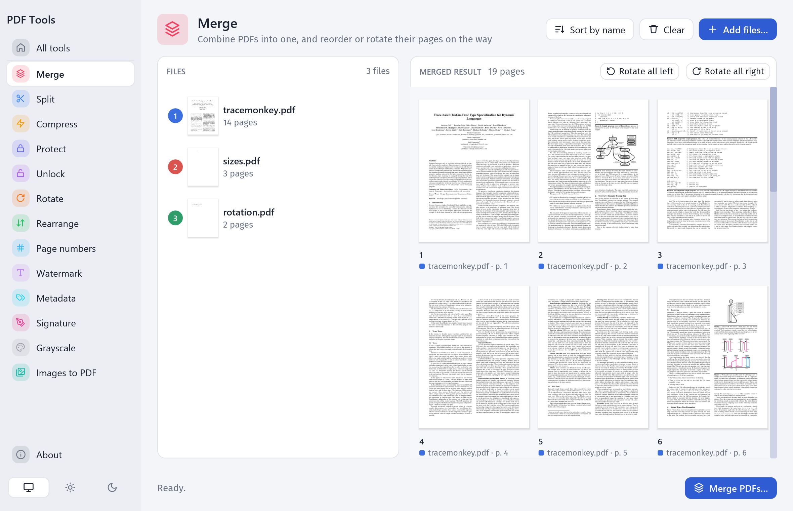
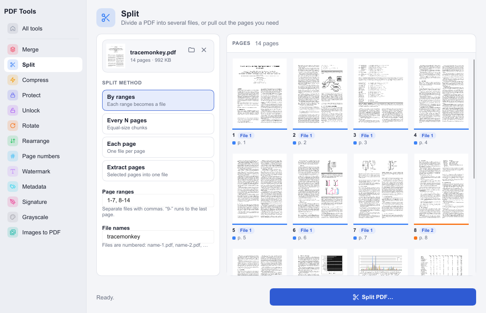
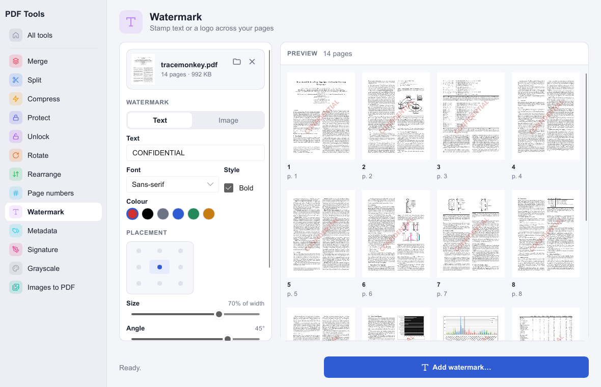
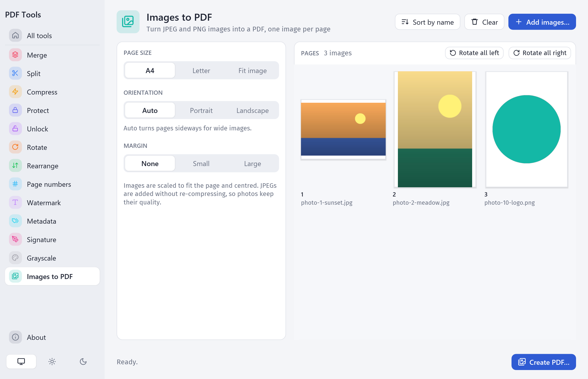

# PDF Tools

[](https://github.com/ivadim/pdf-tools/actions/workflows/ci.yml)
[](https://scorecard.dev/viewer/?uri=github.com/ivadim/pdf-tools)
[](LICENSE)
[](https://buymeacoffee.com/ivadim)

A cross-platform desktop toolset for working with PDFs, written in Rust with an [iced](https://iced.rs) UI.
Everything runs locally; files never leave your computer.

It is a single native executable, about 10 MB, with no web view and no runtime to install. Idle, it uses about 40 MB of memory.

**Try it in your browser: [ivadim.github.io/pdf-tools](https://ivadim.github.io/pdf-tools/)** (experimental). The same PDF engine runs as WebAssembly, so files still never leave your computer. In Chrome or Edge you can install it as an app (the install icon in the address bar, or *Install app* in the sidebar) to pin it to your desktop or dock and open PDFs with it; it then works offline too.



<details>
<summary>In the dark theme</summary>



</details>

## Download

**In the browser:** open [ivadim.github.io/pdf-tools](https://ivadim.github.io/pdf-tools/). Nothing to install, or install it as an app from Chrome or Edge.

**Desktop app:** get the latest build for your system from [Releases](https://github.com/ivadim/pdf-tools/releases):

| System | File | How to run |
| --- | --- | --- |
| Windows 10/11 (x64) | `pdftools-…-windows-x86_64-setup.exe` | Run the installer. It installs for your account without administrator rights (or for all users, if you choose), and adds PDF Tools to the Start menu and to *Settings → Apps* for uninstalling. It isn't code-signed, so SmartScreen may ask you to confirm: choose *More info* → *Run anyway*. |
| Windows, portable | `pdftools-…-windows-x86_64.zip` | Unzip and run `pdftools.exe`; nothing is installed. |
| macOS 11+ (Apple silicon) | `pdftools-…-macos-arm64.dmg` | Open the disk image and drag *PDF Tools* onto *Applications*. The first time, macOS blocks it: see below. |
| Linux (x86_64, glibc 2.35+) | `pdftools-…-linux-x86_64.tar.gz` | Extract and run `./pdftools`. Works on X11 and Wayland. File dialogs use the XDG desktop portal, which most desktops provide. |

**First launch on macOS.** The app isn't notarized by Apple yet, so macOS says *"PDF Tools.app" Not Opened*. To allow it once:

1. Click **Done** in that message.
2. Open **System Settings → Privacy & Security**, scroll down to *Security* and click **Open Anyway** next to "PDF Tools.app was blocked".
3. Confirm with your password, then click **Open**.

Or run this in Terminal, then open the app as usual:

```bash
xattr -dr com.apple.quarantine "/Applications/PDF Tools.app"
```

**Checking a download.** Releases after 0.3.0 come with a `SHA256SUMS` file and a signed attestation that the file was built by this repository's CI from the tagged commit. With the [GitHub CLI](https://cli.github.com):

```bash
gh attestation verify pdftools-…-linux-x86_64.tar.gz --repo ivadim/pdf-tools
```

Builds of the latest `main` are attached to each [CI run](https://github.com/ivadim/pdf-tools/actions/workflows/ci.yml) as artifacts.

## Tools

| Tool | What it does |
| --- | --- |
| **Merge** | Combine PDFs. You can reorder files and individual pages (with the arrows that appear on each) and rotate pages. |
| **Split** | Split by ranges (`1-3, 4-`), every N pages or each page, or extract selected pages into one file. The preview colours pages by output file. |
| **Compress** | *Lossless* drops unused data. *Balanced* and *Strong* also downscale and re-encode large images as JPEG. |
| **Protect** | AES-256 password, plus optional print, copy, edit and annotate restrictions. |
| **Unlock** | Remove a password (you need to know it) or permission restrictions. |
| **Rotate** | Rotate single pages or all pages. Bookmarks and forms are kept. |
| **Rearrange** | Reorder, duplicate or delete pages. Bookmarks and forms are kept. |
| **Page numbers** | Add page numbers at any of 6 positions with formats like `Page {n} of {total}`, a start number and a page selection. Uses the built-in Helvetica font, so Latin characters only. |
| **Watermark** | Text in any installed font and script, or an image. Set size, angle, opacity, position, and draw above or behind the content. |
| **Metadata** | Edit title, author, subject, keywords, creator and producer. |
| **Signature** | Draw, type or upload a signature, then drag and resize it on one or more pages. |
| **Grayscale** | Converts colours in page content, forms, annotations, palettes and images. Text stays real text. Gradients and spot colours are left as they are, and calibrated colours are converted as plain RGB. |
| **Images to PDF** | Turn JPEG and PNG images into a PDF, one per page. Reorder and rotate them, and choose the page size (A4, Letter or the image's own size), orientation and margin. JPEGs are embedded without re-compression, camera rotation (EXIF) is honoured and PNG transparency is kept. |

| | |
| --- | --- |
|  |  |
| **Merge**: reorder files and pages, rotate or leave out pages | **Split**: pages are coloured by the file they'll end up in |
|  |  |
| **Watermark**: see the result on every page before saving | **Images to PDF**: each photo on a page of the right shape |

**Leaving pages out:** in Merge, Rotate, Compress, Protect, Metadata, Grayscale, Page numbers and Watermark, untick a page's checkbox (Shift-click for a range) to drop it from the result. Removed pages stay in the preview, dimmed, so you can include them again. They're removed before the tool runs, so page numbers and "{total}" count only the pages that remain.

Every tool previews pages live, including overlays for page numbers and watermarks. Click a page to see it full size. You can drop files anywhere on the window, and a locked file can be handed to Unlock in one click.

The app follows the system's light or dark appearance; the switch at the bottom of the sidebar picks one instead, and is remembered.

## Develop

The build uses [Bazel](https://bazel.build) with [rules_rust](https://github.com/bazelbuild/rules_rust). The only prerequisite is [Bazelisk](https://github.com/bazelbuild/bazelisk) (`brew install bazelisk`, `winget install Bazel.Bazelisk`, or `npm install -g @bazel/bazelisk`), which runs the Bazel version in `.bazelversion`. Bazel downloads a pinned Rust toolchain on every platform.

Linux builds are hermetic: [hermetic-llvm](https://github.com/hermeticbuild/hermetic-llvm) supplies the compiler and linker and builds the C runtime from source (linked against glibc 2.28, so the binary runs on any distribution since 2018), and fontconfig, X11 and Wayland are loaded at runtime. Nothing needs installing, and any host can build for Linux with `--platforms=//:linux_x86_64` or `//:linux_aarch64`. On macOS and Windows the build uses Xcode or Visual Studio's C toolchain for linking. The text-rendering tests use the system's fonts, so on Linux they need fontconfig and a font (`apt-get install libfontconfig1 fonts-dejavu-core`).

Then:

```bash
bazel run --config=release //crates/pdftools-app:pdftools     # build and start the app
bazel build --config=release //crates/pdftools-app:pdftools   # bazel-bin/crates/pdftools-app/pdftools(.exe)
bazel test //...                                              # every test
bazel build --config=rustfmt //...                            # check formatting
bazel run @rules_rust//:rustfmt                               # fix formatting
bazel build --config=clippy //...                             # Clippy (warnings fail the build)
(cd web && npm ci && npm run lint)                            # ESLint for the web version
```

Third-party crates are still declared in the crates' `Cargo.toml` files and pinned by `Cargo.lock`; Bazel reads both (crate_universe in `MODULE.bazel`), so add or update a dependency there and Bazel picks it up. The version lives in `version.bzl`.

`--config=release` (in `.bazelrc`) is tuned for size (`opt-level = "z"`, LTO, stripped, `panic = "abort"`). The PDF renderer, rasteriser and compression crates are built at `opt-level = 3`, so previews stay fast. Dependencies build at `opt-level = 2` in development builds too, so debug previews aren't slow.

The UI tests save screenshots of the main screens, in both themes, to `bazel-testlogs/crates/pdftools-app/ui/test.outputs/iced-shots`, which is handy for checking layout changes. `bazel test //crates/pdftools-app:ui --test_arg=--ignored --test_arg=tour` adds more of them.

Helper examples (`bazel run` starts them in Bazel's own directory, so give them absolute paths):

```bash
bazel run //crates/pdftools-core:sample_pdfs -- "$PWD/samples"                  # sample inputs
bazel run //crates/pdftools-core:sample_images -- "$PWD/samples"                # sample photos for Images to PDF
bazel run //crates/pdftools-core:smoke -- "$PWD/samples" "$PWD/smoke"           # every operation, for checking by eye
bazel run --config=release //crates/pdftools-core:try_file -- "$PWD/some.pdf" "$PWD/try"   # timings on a real file
```

### Web version (experimental)

`crates/pdftools-cli` runs every operation from the command line. Built for `wasm32-wasip1`, the same program is the engine of a web page in `web/`, which runs all 13 tools in the browser. It is published at **https://ivadim.github.io/pdf-tools/** by [`pages.yml`](.github/workflows/pages.yml).

```bash
bazel run --config=release //web:serve      # http://localhost:8080 (needs python3)
bazel build --config=release //web:site     # the static site, in bazel-bin/web/site
```

`web/wasi.js` is a small WASI loader with an in-memory file system. A Web Worker (`web/worker.js`) copies each file in once and runs one command per action: `info`, `render` (page previews) and one command per tool. Files never leave the browser. Text watermarks and typed signatures are drawn with the browser's fonts, because WebAssembly can't see the system's.

### Lints and security checks

CI runs these on every push and pull request (the dependency checks also weekly); release builds wait for the lints. Pull requests need the **CI passed** check, which passes only when every CI job did, and CodeQL.

| Check | What it looks at | Configuration |
| --- | --- | --- |
| rustfmt, Clippy | Rust formatting and lints; any Clippy warning fails | `rustfmt.toml`, `clippy.toml`, `.bazelrc` |
| ESLint | The web version's JavaScript | `web/eslint.config.js` |
| [cargo-deny](https://github.com/EmbarkStudios/cargo-deny) | Rust dependencies: known vulnerabilities (RustSec), yanked crates, licences, sources | `deny.toml` |
| [zizmor](https://docs.zizmor.sh) | The GitHub Actions workflows and Dependabot settings | |
| npm audit | The web lint tooling | `web/package-lock.json` |
| [CodeQL](.github/workflows/codeql.yml) | Security analysis of the Rust, JavaScript and workflows, also weekly; results under *Security → Code scanning* | |
| [OpenSSF Scorecard](.github/workflows/scorecard.yml) | The repository's supply-chain practices (branch protection, pinned actions, token permissions, signed releases), weekly | |

[Dependabot](.github/dependabot.yml) proposes weekly, grouped updates for Rust crates, Bazel modules, the web lint tooling and the workflows' actions (pinned to commit SHAs), after a week's cooldown. Security updates come right away. Bazel keeps the resolved crates in `MODULE.bazel.lock`, so on Dependabot's pull requests a [workflow](.github/workflows/dependabot-lockfile.yml) refreshes that file and re-runs CI. Patch updates [merge on their own](.github/workflows/dependabot-auto-merge.yml) once the required checks pass; minor and major ones wait for a review.

`cargo deny check` needs Cargo; Bazel's own toolchain has one (`$(bazel info output_base)/external/rules_rust++rust+rust_*__stable_tools/bin`).

## Testing

| Layer | Where | What it covers |
| --- | --- | --- |
| Unit | `crates/*/src/**` | Every operation on small generated PDFs, plus the app's tools, page ranges, preview rendering, text and signature rasterising |
| Integration | `crates/pdftools-core/tests/real_pdfs.rs` | Every operation on 15 real-world PDFs (`tests/fixtures/pdfjs`). Checks that outputs reopen, text survives, pages and rotation are right, removed pages are gone, encryption round-trips, no colour is left after grayscale, and damaged files don't crash anything |
| End-to-end | `crates/pdftools-app/tests/ui.rs` | The real app (`update` and `view`), driven through iced's headless simulator by clicking visible text and by the messages the widgets send: choosing files and options, reordering, every tool's run on real PDFs, then checking the output files |

```bash
bazel test //...                                 # unit + integration + UI
bazel coverage --combined_report=lcov //...      # coverage, in bazel-out/_coverage/_coverage_report.dat (CI requires 80% of lines; currently ~89%)
```

UI tests replace native file dialogs with scripted answers (`ScriptedDialogs`). They run background jobs inline, so results are deterministic.

## Layout

| Path | Purpose |
| --- | --- |
| `crates/pdftools-core` | PDF operations with no GUI code, built on [`lopdf`](https://crates.io/crates/lopdf) and [`image`](https://crates.io/crates/image). |
| `crates/pdftools-render` | Shared rendering: pages with [hayro](https://github.com/LaurenzV/hayro) (pure Rust), watermark and signature text (system fonts, any script), drawn strokes and page ranges. |
| `crates/pdftools-app/src/app.rs` | The [iced](https://iced.rs) application: state, messages, `update`, `view`, the sidebar and the home screen. |
| `crates/pdftools-app/src/single.rs`, `src/tools` | Tools that work on one PDF share `Single` (the file, pages left out, the last run); each implements `ToolOptions` for its options panel, preview overlays and job. |
| `crates/pdftools-app/src/merge.rs`, `src/images.rs` | The two multi-file tools. |
| `crates/pdftools-app/src/previews.rs` | Page thumbnails rendered in the background, with a cache. |
| `crates/pdftools-app/src/theme.rs`, `src/widgets.rs` | Light and dark colours, widget styles and shared building blocks. |

Every change in the UI is a `Message`; `update` applies it and starts heavy work (rendering, running a tool) as a background task whose result comes back as another message.

## Releases

[GitHub Actions](.github/workflows/ci.yml) runs the tests on Windows, Linux and macOS and checks coverage for every push and pull request. It then builds the packages: the Windows installer ([Inno Setup](https://jrsoftware.org/isinfo.php), `packaging/windows/pdftools.iss`) and portable zip, the macOS disk image and the Linux archive. It also tries them out: it installs and uninstalls the Windows setup silently, and mounts the disk image and checks the app inside. To publish a release, push a version tag:

```bash
git tag v0.1.0
git push origin v0.1.0
```

The tag must be on `main`. The tag's run builds without caches, then attaches all four packages to a new GitHub release with a `SHA256SUMS` file and a signed build-provenance attestation. Releases are immutable once published, and `v*` tags can't be moved or deleted.

## Notes

- Outputs go through a temporary `.part` file and are then renamed, so overwriting an input is safe.
- Merge and Split rebuild the page tree. Merge drops document-level extras (outlines, forms). Rotate, Rearrange and the other single-file tools keep them.
- Damaged files, such as ones cut short by an interrupted download, open with the pages that can be recovered; the app says so, and outputs contain only those pages.
- Files that only restrict permissions open without a password, and outputs from any tool are saved without those restrictions.

## Contributing

See [CONTRIBUTING.md](CONTRIBUTING.md). Report security problems privately, as described in [SECURITY.md](SECURITY.md).

## Support

PDF Tools is free and has no ads or tracking. If it saves you time, you can [buy me a coffee](https://buymeacoffee.com/ivadim). ☕

## Licence

MIT. See [LICENSE](LICENSE).

The test PDFs in `tests/fixtures/pdfjs` come from Mozilla's [pdf.js](https://github.com/mozilla/pdf.js) test suite (Apache-2.0).
